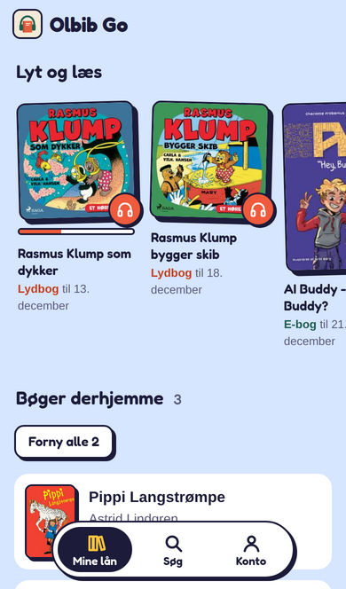
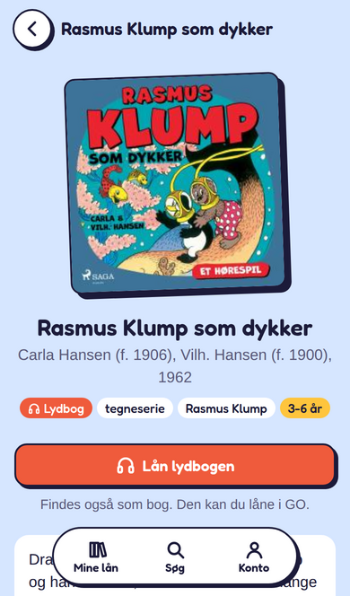
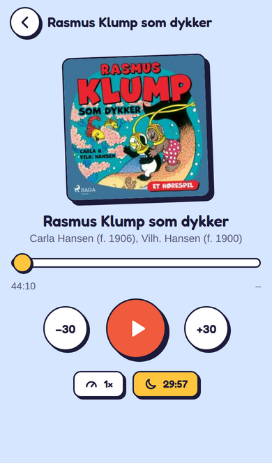

# Olbib Go

En lille, uofficiel webapp til folkebibliotekernes børneunivers [Biblo GO!](https://biblogo.dk) (tidligere eReolen GO), lavet til ældre telefoner. Indtil videre virker den med Københavns Bibliotekers GO ([go.bibliotek.kk.dk](https://go.bibliotek.kk.dk)).

> Olbib Go er et privat hobbyprojekt. Det er ikke lavet af, godkendt af eller tilknyttet Biblo GO!, Det Digitale Folkebibliotek, Københavns Biblioteker eller andre biblioteker, DBC eller WeDoBooks.

<p>
  
  
  
  
</p>

*Mine lån viser eksempeldata. Skærmbillederne er taget med `tools/screenshots.mjs`.*

## Hvorfor

Biblo GO! er en del af Det Digitale Folkebibliotek, og omkring 100 biblioteker i Danmark, på Færøerne, i Grønland og i Sydslesvig har hver deres GO-side. GO virker ikke på vores gamle iPhone, som kører iOS 16 og ikke kan opdateres. Telefonen er ellers fin til at lytte til lydbøger, og et barn kan sagtens bruge den. Det eneste, der mangler, er en vej ind til bibliotekets bøger.

Olbib Go er den vej ind. Det er en simpel webapp, der kan lægges på hjemmeskærmen i Safari (en såkaldt PWA). Den taler med de samme tjenester som GO, med ens eget lånerkort og pinkode, og viser det hele i en brugerflade, der virker i en gammel Safari.

## Hvad kan den

- **Logge ind** med lånernummer eller CPR og pinkode. Man forbliver logget ind på telefonen.
- **Mine lån:** lydbøger og e-bøger, hjemlånte bøger med afleveringsdato, fornyelse (en ad gangen eller alle) og reserveringer med kønummer og afhentning.
- **Søg** mens man skriver, med filtre for lydbøger, e-bøger og fysiske bøger.
- **Låne** lydbøger og e-bøger og **reservere** fysiske bøger.
- **Lytte** til lydbøger: ±30 sekunder, afspilningshastighed, husker hvor man kom til, styring fra låseskærmen og en søvntimer.

E-bøger kan lånes, men ikke læses i appen. Se [E-bøger](#e-bøger) nedenfor.

## Telefoner og browsere

- **Ældre iPhones** (testet med iOS 16): åbn appen i Safari og vælg Del → Føj til hjemmeskærm. Så kører den som en app i fuld skærm.
- **Ældre Android-telefoner:** åbn appen i Chrome og vælg Føj til startskærm i menuen. Den virker på samme måde som PWA.
- **Andre browsere:** appen virker også i almindelige browsere på computer og telefon, fx Firefox, Chrome og Safari.

## Hvad gemmes hvor

Kort sagt: **serveren gemmer ingenting om brugerne.** Alt om et login ligger krypteret i brugerens egen cookie, og serverens log er slået fra.

| Hvor | Hvad | Hvor længe |
|---|---|---|
| **Brugerens cookie** (`lyd`) | Ét krypteret felt med GO's session-cookies, lånernummer og pinkode (så serveren kan logge ind igen, når GO's session udløber efter cirka et døgn), navnet fra GO og enheds-id'et til lydbøger. | Indtil man logger ud, højst 180 dage |
| **Telefonens browser** (localStorage) | Hvor langt man er nået i hver lydbog, den seneste lydbog, afspilningshastighed og valgt søgefilter. | Indtil browserdata slettes |
| **Serverens disk** | Kun en tilfældig hemmelighed (`secret`), som bruges til at kryptere cookies og beregne enheds-id'er. Ingen brugerliste, ingen sessioner. | Fast |
| **Serverens hukommelse** | Kortlivede billetter til lydbogsafspilning (30 min), midlertidige Firebase-tokens (1 time), hvilke enheder der er registreret, og tidspunkter for fejlede logins pr. IP. | Forsvinder ved genstart |
| **Serverens log** | Intet. Logning er slået fra som standard. | – |

Serveren ser naturligvis de data, der passerer igennem den, mens en anmodning står på, fordi den er mellemled til GO. Den gemmer dem bare ikke.

Cookien er krypteret og autentificeret med AES-256-GCM. Den er `HttpOnly`, `Secure` og `SameSite=Lax`, så JavaScript ikke kan læse den, og den ikke sendes med, når andre sider laver anmodninger i baggrunden. En ændret eller for gammel cookie bliver afvist. Hvis serverens hemmelighed udskiftes, bliver alle logget ud.

### Logning

Logning er slået fra. Til fejlsøgning kan den slås til med `LYD_LOG=1`. Så logger serveren hver API-anmodning (metode, sti, status, tid og browser), fejl, og fejl som appen selv indberetter, fx hvis en lydbog ikke kan afspilles. Stien kan indeholde id'et på en titel eller et lån. Lånernumre, pinkoder, søgeord og billet-URL'er logges aldrig.

## Teknisk løsning

```
 iPhone (Safari, iOS 16)                     Server (Node.js)                    Bibliotekets tjenester
┌──────────────────────┐   HTTPS / JSON   ┌───────────────────────┐   HTTPS   ┌──────────────────────────────────┐
│ public/  (PWA)       │ ───────────────▶ │ server/index.mjs      │ ────────▶ │ login.bib.dk (Adgangsplatformen) │
│ vanilla JS, ingen    │                  │  login + sessioner    │           │ go.bibliotek.kk.dk/ap-service:   │
│ build-trin           │ ◀─────────────── │  proxy til GO's API'er│ ◀──────── │   FBI (søgning), FBS (hjemlån),  │
│                      │                  │  cover-proxy          │           │   biblio (digitale lån)          │
│ <audio> ◀── HLS ─────┼──────────────────┼───────────────────────┼─────────▶ │ WeDoBooks (Firebase + CDN)       │
└──────────────────────┘                  └───────────────────────┘           └──────────────────────────────────┘
```

Frontend og backend er bevidst simple: ingen frameworks, ingen build-trin og ingen runtime-afhængigheder på serveren, kun Node.js 24's indbyggede `fetch` og `http`.

### Hvorfor en server?

GO er en Next.js-app, og dens API'er under `/ap-service` er lavet til at blive kaldt fra GO's eget domæne. En webapp på et andet domæne kan ikke kalde dem direkte fra browseren, og den kan heller ikke gennemføre login-flowet, som springer mellem tre domæner med cookies. Serveren gør derfor det, en browser på GO ville gøre, og giver appen et lille, stabilt JSON-API.

### Login

Login går gennem Adgangsplatformen ([login.bib.dk](https://login.bib.dk), DBC's open source-projekt [hejmdal](https://github.com/DBCDK/hejmdal)):

1. Serveren åbner GO's login-link, som via `bibliotek.kk.dk` sender videre til `login.bib.dk/oauth/authorize`.
2. Serveren finder login-formularen og sender lånernummer og pinkode (identitetsudbyderen "borchk").
3. Redirect-kæden fortsætter tilbage via `bibliotek.kk.dk` til `go.bibliotek.kk.dk/auth/callback/...`, som sætter GO's session-cookie.
4. GO's cookies krypteres ind i brugerens egen cookie (se [Hvad gemmes hvor](#hvad-gemmes-hvor)). GO's `/ap-service` accepterer GO's session-cookie alene. Når GO fornyer sine cookies, sender serveren en opdateret cookie med i svaret.

Fejlkoder fra hejmdal (`bonfd`, `bonui`, `tmul` …) oversættes til danske beskeder. Adgangsplatformen tæller forkerte forsøg både pr. bruger og pr. IP-adresse. Alle brugere af én server deler IP-adresse, så serveren tillader højst fem fejlede logins pr. kvarter pr. klient.

### Bibliotekets API'er

Alt går gennem GO's proxy `https://go.bibliotek.kk.dk/ap-service/…`:

| Formål | Endpoint |
|---|---|
| Søgning og værker | `POST /fbi`: DBC's FBI GraphQL (`searchWithPagination`, `getMaterial`, `getManifestationsByFaust`). Forespørgslerne ligger i `server/queries/`. |
| Filtrering på type | FBI-filteret `materialTypesSpecific`: `lydbog (online)`, `e-bog`, `bog` |
| Hjemlån, fornyelse, gebyrer | `GET /fbs/external/agencyid/patrons/patronid/loans/v2`, `POST …/loans/renew/v2`, `GET …/patron/patronid/fees/v2` |
| Reserveringer | `GET/POST /fbs/external/v1/agencyid/patrons/patronid/reservations/v2`, `DELETE …/reservations?reservationid=` |
| Tilgængelighed | `GET /fbs/external/agencyid/catalog/availability/v3?recordid=…` |
| Digitale lån | `GET/POST /biblio/v1/loans` (lån med `{ "material_id": "<ISBN>" }`), `GET /biblio/v1/users/get_loan_quotas` |
| Metadata og forsider for digitale titler | `GET /pubhub-adapter/v1/products/<ISBN>` |

FBS-endpointsene er dokumenteret i den åbne OpenAPI-beskrivelse i [dpl-react](https://github.com/danskernesdigitalebibliotek/dpl-react) (`src/core/fbs/fbs-adapter.yaml`). Resten er fundet ved at se på den trafik, GO selv sender, når man bruger GO med sin egen konto.

### Lydbøger

Lydbøger leveres af WeDoBooks via Firebase:

1. `POST /ap-service/biblio/v1/auth/create-sign-in-token` giver et Firebase custom token.
2. Det byttes til et ID-token hos Google Identity Toolkit (`accounts:signInWithCustomToken`) med GO's offentlige Firebase-nøgle. Nøglen ligger ikke i koden: serveren læser den fra GO's forside (`firebaseApiKey`), når den skal bruges første gang.
3. Afspilleren registreres som en "enhed" (`Devices-add`, `Devices-set_active`). WeDoBooks tillader **højst 6 enheder pr. konto**, så Olbib Go bruger ét fast enheds-id pr. lånerkort (en HMAC af lånernummeret med en hemmelighed på serveren). Ellers ville hvert nyt login bruge en enhed.
4. `Streaming-audiobook_playlist?checkoutId=…` returnerer en HLS-playliste (AES-128) med signerede URL'er til lydfiler og nøgle på WeDoBooks' CDN.

Appen får playlisten fra sin egen server via en kortlivet billet-URL, og afspillerens `<audio>`-element henter selv lydfilerne fra CDN'et. Safari, også på iOS 16, afspiller HLS direkte. Andre browsere (Firefox, Chrome) bruger [hls.js](https://github.com/video-dev/hls.js), som kun hentes, når der er brug for det.

iOS tillader kun, at lyd startes direkte i et tryk. Billetten hentes derfor allerede, når afspilleren åbnes, så `play()` kan kaldes med det samme, når man trykker.

### E-bøger

E-bøger er kopibeskyttede. GO's læser (Colibrio) sender en offentlig RSA-nøgle til `Streaming-ebook_resource` og får bogens indhold i AES-256-krypterede stykker, som den dekrypterer i browseren.

Olbib Go genskaber **ikke** den dekryptering. At omgå kopibeskyttelse er ikke tilladt efter ophavsretslovens § 75 c, heller ikke for bøger man har lånt lovligt. Appen viser derfor e-bogslån, men henviser til GO for at læse dem.

### Forsider

Forsiderne ligger på `images.pubhub.dk` og `fbiinfo-present.dbc.dk`. Deres certifikater kæder op til nyere rodcertifikater (Sectigo R46 og ISRG Root YR), som ældre Apple-enheder ikke kender, så Safari afviser billederne. Serveren henter derfor forsiderne og sender dem videre (`/api/cover`), kun for loggede brugere og kun fra de to værter.

## Kode

```
server/
  index.mjs        HTTP-server: API-ruter, statiske filer, cover-proxy, valgfri logning
  go.mjs           Klient til GO's API'er og WeDoBooks/Firebase
  go-login.mjs     Login-flowet og en simpel cookie-krukke
  store.mjs        Krypterer og læser sessionen i brugerens cookie
  queries/         FBI GraphQL-forespørgsler
public/            PWA'en: index.html, app.js, style.css, sw.js, manifest, ikoner, skrift
ops/               systemd-unit og deploy-script
tools/             Værktøjer brugt under udviklingen (se nedenfor)
```

### Kør lokalt

Kræver Node.js 24.

```sh
INSECURE_COOKIE=1 LYD_DATA=data node server/index.mjs
# åbn http://127.0.0.1:3800
```

| Miljøvariabel | Standard | Betydning |
|---|---|---|
| `PORT` / `HOST` | `3800` / `127.0.0.1` | Hvor serveren lytter |
| `LYD_DATA` | `./data` | Mappe til serverens hemmelighed (`secret`) |
| `LYD_LOG` | ikke sat | Sæt til `1` for at slå logning til |
| `INSECURE_COOKIE` | ikke sat | Sæt til `1` for at køre over almindelig HTTP lokalt |

I drift kører serveren som en systemd-brugerservice (`ops/bibliotek.service`) bag en reverse proxy, der står for HTTPS.

### Udviklingsværktøjer

`tools/` indeholder de scripts, API'et blev kortlagt og testet med:

- `record.mjs` åbner en Chrome med egen profil og gemmer al trafik i `capture/traffic.jsonl`, mens man selv bruger GO.
- `show.mjs` viser udvalgte anmodninger fra optagelsen.
- `smoke.mjs`, `ui-check.mjs`, `player-fit.mjs` og `cover-check.mjs` er røgtest af API og brugerflade mod en kørende server.
- `screenshots.mjs` tager skærmbillederne til denne README, med eksempeldata i stedet for rigtige lån.
- `devices.mjs` viser (og med `--clean` fjerner) de WeDoBooks-enheder, Olbib Go har registreret.

**Pas på:** optagelsen i `capture/` indeholder dit lånernummer og din pinkode i klar tekst. Mappen er i `.gitignore` og må aldrig deles. Testscriptene læser loginoplysningerne derfra.

## Forbehold

Olbib Go bruger bibliotekets tjenester på samme måde som GO, med brugerens egen konto, og kun til det, brugeren selv har ret til: egne lån, egne reserveringer og afspilning af lånte lydbøger. Den omgår ikke kopibeskyttelse af e-bøger. Bibliotekets API'er er ikke offentligt dokumenterede og kan ændre sig uden varsel, så appen kan holde op med at virke.
